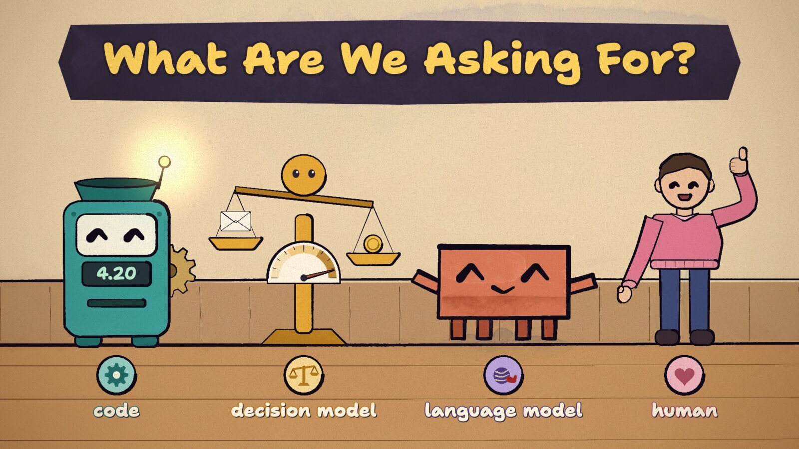

# Claude Creative Playbook

How we make teaching songs into hand-painted, karaoke-captioned music videos with Claude Code, and the small web pages that drive them. Everything here comes from real projects. The latest is *What Are We Asking For?*, a 4½-minute sing-along about when to use plain code, a decision model, a language model or a human.

## The pipeline at a glance

1. **Song.** Turn an explanation into lyrics, generate the track (we use Suno), and read the audio before drawing anything: lyrics, tempo, and word-by-word timing from speech-to-text. → [docs/1-song.md](docs/1-song.md)
2. **Storyboard and world.** Write a storyboard first: one world, a cast where each character *is* a concept, motifs that pay off, shots keyed to sung words, and a seam contract between sections. Then build one shared world file and look at its test loops before any shot exists. → [docs/2-storyboard.md](docs/2-storyboard.md)
3. **Parallel build.** One Claude agent per section, all at once, each checking its own work with contact sheets and frame strips. One integrator checks the seams. → [docs/3-build.md](docs/3-build.md)
4. **Karaoke.** A painted banner whose words fill as they are sung, with a tiny mascot hopping word to word. → [docs/4-karaoke.md](docs/4-karaoke.md)
5. **Render and share.** Render frames in parallel with headless Chrome, encode, make a phone-sized copy, and put a title card on frame 0 so the Slack thumbnail isn't black. → [docs/5-render-and-share.md](docs/5-render-and-share.md)
6. **The page is the medium.** Each video is a single web page that can scrub, jump and toggle layers through URL switches. The same habits make good standalone pages. → [docs/6-pages.md](docs/6-pages.md)

Then: [prompts.md](prompts.md) has the prompts that started each step, and [docs/lessons.md](docs/lessons.md) lists the things that bit us.

## What you need

- [Claude Code](https://claude.com/claude-code). We used Opus as the planner and integrator and parallel Opus agents as section builders.
- The animation engine: [JohnHeibel/ClaudeAnimationBase](https://github.com/JohnHeibel/ClaudeAnimationBase) (MIT). It's p5.js plus p5.brush, with a brush-painted character (Clawd), shots, transitions, a camera and a headless renderer. Clone it and read its `ANIMATION_GUIDE.md`. This playbook is about what we built on top of it.
- Node.js, Google Chrome, ffmpeg (`brew install ffmpeg`).
- For word timing on a Mac: `pipx install mlx-whisper`. For beat analysis, [uv](https://docs.astral.sh/uv/) so librosa runs in a throwaway environment: `uv run --with librosa python …`.
- A song. Ours came from [Suno](https://suno.com).

## What's in this repo

| path | what |
|---|---|
| [docs/](docs/) | the guide, one file per step |
| [prompts.md](prompts.md) | prompts to paste into Claude Code |
| [scripts/word_times.sh](scripts/word_times.sh) | whisper word timestamps for a song |
| [scripts/align_lyrics.py](scripts/align_lyrics.py) | snaps whisper's words onto the official lyrics, so every lyric word has a start and an end |
| [scripts/release.sh](scripts/release.sh) | encodes the frames into a shareable MP4 that opens on a title card (fixes black thumbnails), with a phone-sized option |
| [examples/karaoke_overlay.js](examples/karaoke_overlay.js) | the karaoke banner and tier-ladder overlay from *What Are We Asking For?* |
| [examples/title_card.js](examples/title_card.js) | the title card / thumbnail scene |
| [images/](images/) | stills, a contact sheet and test loops from the project |

The two example files are written against the ClaudeAnimationBase API (`paint`, `clawd`, `letter`, `shots`, …) and this project's world file. Read them as worked examples to adapt, not as drop-in modules.

## Time and cost, roughly

For the 4:29 video on an M4 Pro MacBook, the whole thing took one Claude Code session. The six section builders ran in parallel for 35–50 minutes each. Rendering the 6,461 frames with 6 workers took about 20 minutes (frames cost 50–370 ms each), and encoding took a few minutes.
