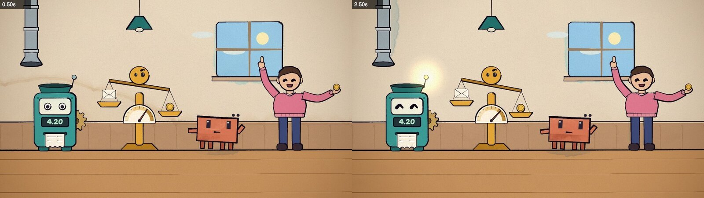

# 2. Storyboard and world

Always storyboard before writing any shot code. ClaudeAnimationBase's `ANIMATION_GUIDE.md` makes this a rule, and it matters even more when several agents will build parts of one film. The storyboard is a Markdown file in the repo (`STORYBOARD.md`) that every builder reads.

## What goes in it

1. **Logline.** One sentence with a character who wants something and a change by the end. Ours: *Clawd runs a little workshop where jobs arrive by tube, keeps reaching for the wrong tool, learns to ask "what are we asking for?" first, and ends up running a cascade where every handoff upward sends a better rule back down.*
2. **One world.** A single set that can change mood, rather than a new location for every scene. Ours is a workshop whose window light carries a colour arc: dawn (intro) → day (verses) → dusk (the bridge, where the stakes are) → golden (everything working together) → evening, with the lamps on (outro).
3. **A cast where each character *is* a concept.** This is the most important teaching decision. Each tier got a character, a colour, an icon and a behaviour that demonstrates it:

   | tier | character | colour | what it does on screen |
   |---|---|---|---|
   | code | **Cogs**, a boxy counting machine | teal | eats coins, prints identical receipts every time |
   | decision model | **Scale**, a balance with a gauge face | gold | weighs signs, can only point at the bins *we* defined, shows a score like 0.92, not an essay |
   | language model | **Clawd** (it's Claude!) | violet | corkboard, sticky notes, red yarn joining the threads, drafts a plan; a "that's me!" moment, then notices it costs a stack of coins where Scale costs one |
   | human | **Sam**, behind a door | rose | weighs coins against a house on two palms, gives the thumbs-up |

   

4. **Motifs that recur and pay off.** Viewers learn from repetition with variation. Ours: the job arriving by tube (Clawd can't read it at first and knows it at a glance by the end), the chorus shape-sorter (one more hole each time), rule cards (Clawd writes the first one in verse 1, and a new glowing one slides back down to Cogs in the final verse), and cost shown as coin stacks.
5. **The main character's emotional arc**, section by section. Ours: curious → proud → flustered → careful → joyful → "that's me!" → humble → conductor → content.
6. **Shots keyed to sung words**, for example "Scale's needle settles on *score*". Use the word times from step 1, not guesses.
7. **A text policy.** The kit's rule is no text on screen: the lyrics are acted, never written. For a teaching video we relaxed that exactly this far: karaoke and the tier ladder are drawn by the overlay only, and numbers are allowed where they teach (Cogs' display, a gauge score). No labels or captions anywhere else.
8. **Layout rules.** The overlay owns the bottom 130 px (the karaoke banner) and the right edge (the tier ladder), so builders keep faces and key props out of those areas.
9. **A seam contract** (below).

## The seam contract

When different agents build neighbouring sections, the cut between them only works if both sides agree exactly. The storyboard gives the exact code each side runs at every seam, in absolute video time:

| seam | t | out (last shot of the previous section) | in (first shot of the next section) |
|---|---|---|---|
| start | 0 | — | `flash(1 - ease(seg(t, 0, 1.4)), PAL.ink)` (fade up from ink) |
| V1→V2 | 23.2 | `if (t > 22.9) brushWipe((t - 22.9) / .6, [WA.codeDk, WA.code])` | `if (t < 23.5) brushWipe((t - 22.9) / .6, [WA.codeDk, WA.code])` |

With this in place, eight seams between six independently built files all cut cleanly on the first integration pass.

## A shared world file, before any shot

Put everything that two sections might both draw in one file that the planner writes before the builders start. For us that was `wa_world.js`:

- the palette, the tier colours and the section start times (`SEC = { v1: 9.2, v2: 23.2, … }`);
- the word-time helpers (`wq(line, 'word')`);
- the set (`workshop(t, { mood })`);
- the cast (`cogs()`, `scaleBot()`, `human()`; Clawd comes with the kit);
- every shared prop (`envelope`, `ticket`, `ruleCard`, `coin`, `gauge`, `bin`, `stickyNote`, `yarn`, `door`, `sorter`, `peg`, `tierIcon`, …).

Every function is a pure function of time and its arguments, so any frame can be rendered on its own, in any order, by any worker.

**Register test loops and look at them.** The world file also defines loops (`LOOPS.wa_cast`, `wa_props`, `wa_human`) that put every character and prop on screen. Render them and look before any builder starts. This check caught problems that would otherwise have shown up six times over:

- a thumbs-up hand that didn't read as a thumbs-up;
- a pointing hand in an earlier video that read as a middle finger;
- clapping gloves that looked like bowling pins;
- Cogs' "dizzy" swirl eyes drawn too thick to read.

```bash
node render.mjs --page=wawaf.html --loop=wa_cast --sheet=0.5,2.5 --cols=2 --out=out/check/cast.jpg
```
