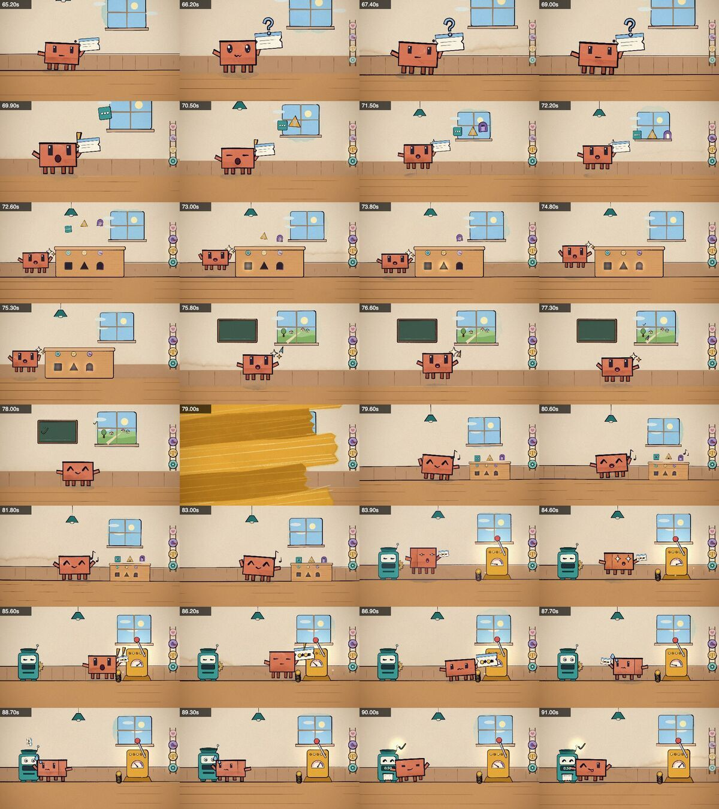

# 3. Build in parallel

## One agent per section

Once the storyboard and world file exist, the film splits cleanly. Each section is one file containing one self-contained block that registers its shots in absolute video time. A shot is `[startTime, fn]`, where `fn(t, lt, dur)` paints the whole frame as a pure function of time:

```js
// wa_v3.js: verse 3 (91.9–119.4), the language model. One continuous world, shot by a moving camera:
//   A 91.9–97.9   Cogs jams and coughs, envelopes pile out; a burst of sticky notes (scattered evidence) flies up.
//   B 97.9–106.4  whip pan after the notes to Clawd's corkboard; "a language model" — that's me!; red yarn …
(() => {
  function verse3(t, lt, dur) { workshop(t, { mood: 'day' }); /* … */ }
  shots([[SEC.v3, verse3]]);
})();
```

Start each file with a comment that gives the shot plan and the word cues, like the one above. It is the builder's plan, and it's what the integrator reads first.

Every section file is listed in the page's HTML *before* the builders start, so no builder edits a shared file. Then Claude Code starts the builders as parallel agents (we used forks of the planning session, so each one already had the full context). Each one's brief says:

- your section, your time span and your file;
- the seam contract for your two edges;
- read the storyboard, the world file and the kit's animation guide;
- run your own review loop, and report anything you'd change in the shared files instead of changing them.

| file | span |
|---|---|
| `wa_intro_v1_outro.js` | intro, verse 1, and the outro (so the ending can rhyme with the opening) |
| `wa_v2_pre.js` | verse 2 and the pre-chorus |
| `wa_chorus.js` | `chorusShots(c0, …)`: one builder, used for all three choruses, which vary on each repeat |
| `wa_v3.js` | verse 3 |
| `wa_bridge.js` | the bridge |
| `wa_final_verse.js` | the final verse |

Builders took 35–50 minutes each, all running at once.

**Relay fixes between builders.** When one builder found a bug in shared behaviour, the integrator passed the fix to the others. One example: lettering drawn with `letter()` (Cogs' "4.20" display) sits on top of everything painted later, so it showed through wipe transitions until `flushLetters()` was called before each wipe.

## The review loop: Claude looks at its own frames

Builders don't guess what a frame looks like; they render it and look. The kit's renderer has three views of the same moment:

```bash
# contact sheet: the shape of a whole section (a frame every 0.5–1 s)
node render.mjs --page=wawaf.html --sheet=65.2,66.2,67.4,69,69.9 --cols=4 --out=out/check/c1.jpg
# strip: every frame of a short moment (a take, a jump, a transition)
node render.mjs --page=wawaf.html --strip=78.6:79.6 --out=out/check/wipe.jpg
# crop: full-resolution detail (a face, a hand, a contact point)
node render.mjs --page=wawaf.html --sheet=88.7 --crop=760,300,400,400 --w=600 --out=out/check/face.jpg
```



Claude reads these images and fixes what it sees: overlapping characters, a prop that pops instead of moving, a face too small to read, an action that lands on the wrong word.

## Integration

The planning session acts as integrator:

1. A whole-film contact sheet with a frame every 3 s, to check the shape and colour arc.
2. A sheet around every seam (±0.3 s), to check the cuts.
3. A list of the builders' known issues, each fixed or consciously accepted.

Then render.
