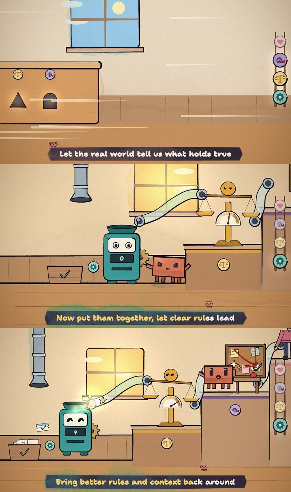

# 4. Karaoke



The karaoke and the tier ladder live in a single overlay file ([examples/karaoke_overlay.js](../examples/karaoke_overlay.js)) that draws over every shot. No section builder ever draws lyrics. That keeps the lyrics consistent across six builders, and one switch (`?clean` in the URL) turns them off for a clean render.

## How it works

- **Data.** The word-timed lyrics from [step 1](1-song.md): every word has `t0` and `t1`.
- **Banner.** A painted ink banner (the kit's `paint()`, an ink wash with a watercolour fill in the colour of the current tier) sits at the bottom of the frame. Because it's painted in the scene, it boils and sits under the paper grain like everything else, rather than looking like a subtitle stuck on top.
- **Words.** The words are drawn in the 2D compositor after the frame and before the grain, in Shantell Sans 800. Each word is cream, and a clip rectangle fills it with gold from `t0` to `t1`, so held notes fill slowly and quick words snap.
- **The hopping mascot.** A tiny Clawd (`u = 4.2`) sits on the current word and hops to the next one, landing just as that word starts. The hop height grows with the distance between the words.
- **Handover.** When one line follows straight on from the last (it starts within 1.2 s of the previous line's end), the banner passes directly to the new line instead of shrinking and growing back. After a real gap it shrinks away.
- **Font.** The font is a local file (`assets/fonts/ShantellSans.ttf`, SIL OFL) loaded with `FontFace`, and the overlay holds the render entry points until it has loaded. No frame may render in a fallback font, and nothing should wait on the network.

```js
const face = new FontFace('WA Shantell', 'url(assets/fonts/ShantellSans.ttf)', { weight: '300 800' });
document.fonts.add(face);
const ready = face.load().catch(() => {});
for (const k of ['renderAt', 'renderSheet']) { const f = window[k]; window[k] = async (...a) => { await ready; return f(...a); }; }
```

## The tier ladder: always show where we are

The same overlay draws a painted ladder on the right edge, with one rung per tier: code at the bottom, the human at the top. Whichever tier the song is about lights up, so a viewer who looks away for a moment still knows which concept is on screen. In the final verse it sweeps up on "Handing off isn't falling down" and back down on "Bring better rules and context back around": the escalate-then-improve loop, shown by the interface itself.

## Without word timing

If you only have line-level timing (an SRT), fill each line at an estimated singing pace instead: spread `min(lineLength − 0.1, 0.45 + 0.075 × characters)` seconds across the letters. That's what we did on the earlier song. It's fine for a steady pop track but drifts on held notes, which is why the rubato song got whisper timing.

## Other caption options

- **Soft captions.** Mux an SRT into the MP4 as a toggleable subtitle track: `ffmpeg -i video.mp4 -i lyrics.srt -map 0 -map 1 -c copy -c:s mov_text -metadata:s:s:0 language=eng out.mp4`.
- **Two renders.** Render a karaoke cut and a clean cut into separate frame folders: `--query=clean --frames-dir=out/frames_clean`.
